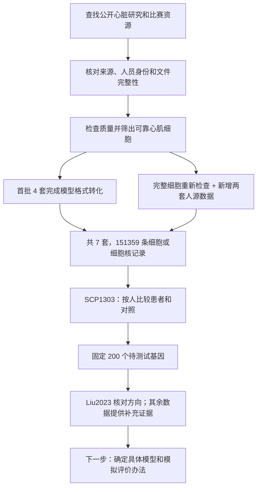

# HCM 项目工作总览：从数据准备到候选基因

更新日期：2026 年 11 月 15 日。本文是项目的总入口，用于快速了解已经完成的工作和下一步。较早的阶段报告记录的是当时状态，当前进度以本文为准。

## 一分钟了解目前结果

我们的目标是研究肥厚型心肌病（HCM），先找到值得测试的基因，再用 Geneformer 模型模拟改变这些基因，观察心肌细胞的状态是否可能向对照靠近。

目前已完成 **7 套数据的心肌细胞筛选和模型格式转化，共 151,359 条细胞或细胞核记录**；已从中按预先确定的规则选出 **200 个待测试基因**，并用其他数据检查支持程度。

在 Liu2023 数据中，200 个基因有 **158 个变化方向一致**，其中 **141 个在分别去掉任一位对照后仍然一致**；另有 **42 个方向相反**，也完整保留在结果表中。

我们这条工作线目前完成到候选基因和证据整理。**模拟敲除、模型训练和真实实验验证尚未由本流程完成；200 个候选不等于 200 个已经证实有效的治疗靶点。**

## 1. 我们一路做了哪些工作

| 时间 | 做了什么 | 得到什么 |
|---|---|---|
| 11 月 10 日起 | 查找并下载公开心脏研究和比赛数据，检查文件完整性 | 原始文件、来源清单和检查记录 |
| 11 月 11—12 日 | 按数据类型检查质量，识别心肌细胞，复查输出文件 | 13 套资源完成各自适用的清洗或整理；另 1 套因缺少可靠基因名称而排除 |
| 11 月 12 日 | 首先把 4 套成人心肌数据转成 Geneformer V1 可读取的格式 | 4 套独立结果，共 136,942 条记录 |
| 11 月 14 日 | 为完整细胞数据修订适用规则，补充两套人源 HCM 数据，再完成转化 | 新增 3 套可用结果，共 14,417 条记录；累计 7 套 |
| 11 月 15 日 | 比较患者与对照，检查结果是否受个别人影响，固定候选名单，再用其他研究核对 | 200 个候选基因、逐项证据表、报告和完整结果压缩包 |

## 2. 为什么以前说 13 套，现在使用 7 套

此前的 **13 套是不同用途的资源总数**：7 套心脏细胞研究、1 套心肌组织整体测量、5 套比赛资源。它们都经过了适合各自类型的检查，但只有一部分适合当前的 HCM 心肌基因任务。

首批从中选择了 SCP1303、Chin 两套、Liu2023，共 4 套。之后重新处理了原有的 GSE138262，再补充新下载的 GSE255296 和 GSE292754，形成现在的 **4 + 3 = 7 套**。所以“7 套”并不表示其余原始文件丢失了，也不是 7 组完全独立的患者与对照实验。

### 当前使用的七套

下表是**清洗后实际保留的结果**。一人可以提供很多细胞或细胞核，这些记录数不能当作人数。

| 数据来源 | 保留的心肌细胞或细胞核 | 人员构成 | 当前用来做什么 |
|---|---:|---|---|
| [SCP1303 / Chaffin 研究](https://singlecell.broadinstitute.org/single_cell/study/SCP1303) | 114,711 | 15 位 HCM、16 位非衰竭对照 | 主要用于寻找候选基因；非衰竭不等同于已证明完全健康 |
| [Chin：GSE174691](https://www.ncbi.nlm.nih.gov/geo/query/acc.cgi?acc=GSE174691) | 10,150 | 9 位 HCM | 提供患者侧补充证据 |
| [Chin：GSE161921](https://www.ncbi.nlm.nih.gov/geo/query/acc.cgi?acc=GSE161921) | 3,534 | 4 位对照 | 与上一套配合观察；来源差异也可能影响结果 |
| [Liu2023 / Cell Discovery](https://www.nature.com/articles/s41421-022-00490-3) | 8,547 | 10 位 HCM、2 位对照 | 候选名单固定后，再核对变化方向 |
| [GSE138262 及作者配套对照](https://www.ncbi.nlm.nih.gov/geo/query/acc.cgi?acc=GSE138262) | 3,595 | 5 位 HCM、7 位对照 | 提供完整心肌细胞的补充观察；两组来源和测量技术不同 |
| [GSE255296 人源部分](https://www.ncbi.nlm.nih.gov/geo/query/acc.cgi?acc=GSE255296) | 7,516 | 4 位 HCM，个体年龄仍待确认 | 检查候选基因在另一批患者细胞中是否可见 |
| [GSE292754 新增儿童部分](https://www.ncbi.nlm.nih.gov/geo/query/acc.cgi?acc=GSE292754) | 3,306 | 2 位儿童 HCM，14 岁和 16 岁 | 单独观察儿童数据中的基因覆盖情况 |
| **合计** | **151,359** | **74 个研究内人员记录** | 各研究分别保存和使用 |

“74”是各研究人数相加；不同研究是否包含同一个人，还没有完全排除。Liu 的两次 CL0412 采样属于同一个人，已经合并计算人数。新增研究复用的 Chin 样本、儿童 P86 也没有再次算作新患者；GSE255296 中的猫、鼠数据没有进入本项目心肌集合。

### 其余资源保留作什么用途

| 资源 | 没有进入本次七套主流程的原因 |
|---|---|
| GSE181764 | 已清洗，但对照最终只剩 5 个心肌细胞核，无法支持可靠的患者与对照比较，保留作受限补充 |
| GSE203274 | 已清洗，但只有 1 位儿童 HCM 患者；不能用同一个人的很多细胞代表很多患者，保留作儿童研究补充 |
| GSE249925 | 测量的是一块心肌组织的整体信号，不能拆成单个心肌细胞；文件是否已被作者调整数值也有待进一步确认 |
| VCC2025、NeurIPS2023、NeurIPS2021、CausalBench2023 | 可以学习模型、实验干预和评估方法，但不是可直接用作 HCM 患者与对照的心肌数据 |
| ACDC2017 | 包含 HCM 心脏影像，可用于影像学习；没有 Geneformer 所需的细胞基因表达表 |
| GSE227734 | 缺少可靠的基因对应表，无法确定每列代表什么基因；按用户决定停止处理，未向作者发邮件 |

早期还排除了 GSE145154（不含 HCM）和 GSE130652（小鼠、且数据类型不适合本任务）。各项取舍有来源记录，不是只按文件大小或细胞数量选择。

## 3. 清洗具体做了什么

清洗的目的是让后续比较尽量基于可靠的心肌细胞，同时保留能够追溯原数据的记录。

### 大多数细胞核数据的基础规则

- **每条记录检测到的基因数在 500—5,000 之间，包含两端。** 太少时信息可能不足，太多时需要警惕异常；基因多本身不等于一定有两个细胞混在一起。
- **来自线粒体的信号比例低于 5%。** 线粒体是细胞内负责能量供应的结构；这个比例是质量参考，不能单独决定一个细胞是否正常。
- **再判断是不是心肌细胞。** 综合作者原来的标注、正常心脏参考和一组心肌相关基因，例如 TNNT2、MYH7、TTN；不会仅凭一个基因就作决定，也不要求每条记录都必须检出这三个基因。
- **检查是否混入其他细胞或疑似两个细胞。** 只有多种证据共同支持才排除；证据冲突的记录单独保存为“待复核”。
- **按每位提供样本的人检查保留情况。** 记录哪些人保留了多少、哪些组损失较多，避免只看总细胞数而掩盖一组被筛得过严的问题。

500—5,000 和低于 5% 是本项目预先约定的严格版本，**不是适用于所有研究的行业统一硬标准**。不同来源的原文件也不相同：有的需要先判断是否真的测到了细胞，有的已经被原作者筛选过，因此没有机械地对每套数据重复同一套处理。

### 完整细胞的例外：GSE138262

多数数据只测细胞核，而这套测的是完整心肌细胞。完整细胞的线粒体信号可以明显更高。最早套用同一严格规则时，它只剩 **6 个 HCM 细胞、没有对照**，不适合继续比较。

我们重新核对了作者公开方法，另外建立适合这套数据的版本：先限定为作者最终纳入的细胞，要求去掉线粒体部分后仍有 **超过 1,000 个表达分子计数**，再共同检查心肌身份、异常信号和混合信号。这里的 1,000 指分子计数，不是 1,000 种基因。这套规则不统一套用“线粒体低于 5%”和“最多 5,000 种基因”。

最终保留 **3,595 个心肌细胞：2,216 个来自 HCM、1,379 个来自对照**；另有 97 个候选留待复核。旧版和原始文件均保留。修改依据是这类数据的测量特点和作者方法，没有为了增加数量临时凑数。

### 清洗后留下了什么

每套保留完整的心肌核心文件、人员和疾病信息、清洗规则、筛选数量及文件检查记录；有疑问的细胞另存。可靠性检查包括重新读取文件、与来源逐项对照基因和计数、核对人员与疾病标签，以及检查文件在复制前后是否一致。

原始文件没有丢弃，未测到的基因没有伪造成“测到了但表达为零”。标签中的“对照 / HCM”来自提供样本者的诊断，不能理解为每个细胞都经过单独的病理确诊。完成这些检查，也不能保证每个细胞身份百分之百正确。

## 4. 转化做了什么，结果在哪里

清洗后先保存为 **`.h5ad` 文件**，可以把它理解成“基因表达表，加上每个细胞来自谁、属于哪组等说明”。这是后续比较基因表达的依据。

接着使用 Geneformer 官方的 **`TranscriptomeTokenizer`**，按我们选定的 **V1** 规则，把每个细胞转换成模型能读取的一串基因编号。排序会参考每个细胞的总信号和官方提供的各基因常见表达水平；不是只把原始表达量从高到低排列。每条序列最长保留 **2,048 个基因编号**。

| 转化批次 | 数据 | 完成的记录数 |
|---|---|---:|
| 第一批 | SCP1303、Chin 两套、Liu2023 | 136,942 |
| 第二批 | GSE138262 新版、GSE255296、GSE292754 | 14,417 |
| **累计** | **7 套，各自独立输出** | **151,359** |

每套输出一个 **`.dataset` 文件夹**。其中包括保存主体数据的 Arrow 文件，以及 `dataset_info.json`、`state.json` 两个说明文件。传输和读取时要保留整个文件夹。

两批都逐条检查过编号、排序、长度、细胞来源和疾病标签；转化没有减少核心细胞数量。并不是所有测到的基因都能进入 V1 输入：无法可靠确定身份或不被模型支持的基因不进入序列，超出长度的部分按官方规则截断；原表达表仍保留。

最初为了方便试运行，还建立过轻量子集，例如 SCP1303 的 20,000 条记录。**本轮候选基因分析使用的是完整核心**；没有把轻量子集再加一遍，也没有通过复制细胞凑数量。

转化成功表示数据格式已准备好，不等于模型已经完成训练。最终哪些人用于训练、哪些人用于检验，仍需随具体模型方案确定。

## 5. 200 个候选基因从哪里来

这批候选直接来自 **SCP1303 中 15 位 HCM 患者与 16 位非衰竭对照的比较**。统计时先把同一个人的心肌记录汇总，按人比较，并考虑现有的年龄和性别信息，避免把一个人的几千个细胞误当成几千位患者。

筛选办法先写定，再看结果。具体过程如下：

| 步骤 | 结果 |
|---|---:|
| 排除信号太少、无法可靠比较的基因后，正式检查 | 20,172 个基因 |
| 同时满足预定的统计证据和变化幅度要求 | 4,369 个 |
| 用另一版本的表达计数核对，再逐一去掉 31 人中的每一个重算，变化方向和幅度仍符合要求 | 4,108 个 |
| 再要求基因确实存在于模型输入中，并在足够多患者的细胞里出现 | 544 个 |
| 按事先确定的顺序选取本轮测试规模 | **前 200 个** |

其中“足够多”的具体要求是：15 位 HCM 患者中至少 8 位，各自至少 10% 的心肌细胞核输入包含该基因。这样可以避免选到模型在几乎所有细胞中都看不到的基因。

这 200 个中，**101 个在 HCM 中表达较高，99 个较低**。数量不是为了把两组凑成各一半；也没有额外塞入文献里的熟悉基因补足名额。其他通过要求的基因和所有未入选结果仍保留在完整表中。详细数值门槛放在文末链接的分析方案中。

SCP1303 是 Geneformer 原论文心肌病任务涉及的来源之一。因此它可以帮助发现表达差异，但如果采用已经接触过这些材料的模型，就不能把它再称作模型从未见过的全新检验数据。实际采用哪个模型、它训练时见过哪些人，还需要核实。

## 6. 其他数据怎样检查这批候选

我们先固定 200 个候选及其顺序，随后才打开 Liu2023 的患者与对照比较结果。这样可以保留一次真正独立于选名单过程的检查，减少“看完结果再改名单”的影响；但不同研究是否涉及同一个人，仍需进一步核实。

“方向一致”是指：在 SCP1303 中 HCM 较高的基因，在 Liu 中也较高；较低的也同样较低。

| Liu2023 检查结果 | 数量 | 怎么理解 |
|---|---:|---|
| 方向一致，而且分别去掉任一位对照后仍一致 | 141 | 方向证据较稳定，值得继续测试 |
| 总体方向一致，但去掉某位对照后发生变化 | 17 | 结果对对照人选比较敏感，需要谨慎 |
| 总体方向相反 | 42 | 两个研究给出的证据存在冲突，不能忽略 |
| 无法检查 | 0 | 本批 200 个都可评估 |

141 + 17 = **158 个总体同向**。Liu 只有 2 位对照，这两次去掉对照的检查共享同一批患者，不能当成两个全新研究。我们没有因此删除那 42 个反向基因，也没有调整原名单顺序。

其余研究提供补充观察：Chin 两套有 119 个同向、52 个反向、29 个信号不足而未比较；完整细胞数据有 63 个同向、46 个反向、91 个不在共同可比较范围。两类数据的患者与对照来源或技术不同，不能把所有差异都归因于 HCM。

GSE255296 和 GSE292754 只有患者，所以用来检查这些基因是否在模型输入中出现，不用它们证明患者与对照有差异。两套都能找到这 200 个基因，但不是每个细胞都包含每个基因。

这些检查说明哪些候选支持较多、哪些存在疑问。**一个基因在疾病中升高，可能是在推动疾病，也可能是身体的保护反应；表达降低同样不代表应该继续把它敲除。** 是否有益要由后续模拟和实验继续判断。

## 7. 文件在哪里，现在应该看什么

| 想了解什么 | 对应文件或位置 |
|---|---|
| 快速了解整个项目 | 本文 `PROJECT_OVERVIEW.md` |
| 浏览 200 个候选 | [中文候选表](https://github.com/zhome1226/hcm-geneformer/blob/virtual-cell/results/target_discovery/hcm_dge_20261115/CANDIDATES_REVIEW.csv) |
| 查每个候选的具体证据 | [完整证据表](https://github.com/zhome1226/hcm-geneformer/blob/virtual-cell/results/target_discovery/hcm_dge_20261115/CANDIDATE_EVIDENCE.tsv) |
| 查看本次筛选过程和流程图 | [候选筛选报告](https://github.com/zhome1226/hcm-geneformer/blob/virtual-cell/results/target_discovery/hcm_dge_20261115/REPORT.md) |
| 查全部基因、逐人检查和分析记录 | 本机 `D:/VirtualCell/deliverables/hcm-dge-20261115/evidence/` |
| 把本次完整结果带到 ToDesk 电脑 | `HCM_DGE_20261115_complete.zip`，约 22.3 MB |
| 把新增三套清洗和模型输入数据带到 ToDesk 电脑 | `HCM_V1_20261114_manual.zip`，约 198 MB |

两个压缩包都在本机 `D:/VirtualCell/deliverables/`。DGE 结果包包含全部结果表、中文表、阶段报告和流程图；它生成后才写了本总览，**本总览需单独复制**，以免拿着旧包找不到新文档。

ToDesk 电脑的数据根目录为 **`D:/hcm-geneformer-data/`**。本次结果 ZIP 建议解压到其中的 `analysis/`，得到 `HCM_DGE_20261115/` 文件夹。数据制作和本机打包校验已经完成；远端是否收全是另一个状态，目前新增三套数据和本次结果包都等待用户手动传输后的确认。首批四套此前由用户补传，本轮没有再次确认远端完整性。

完整原件和处理结果仍保存在 Linux 数据服务器。本次候选分析目录为 `/home/zhome/hcm-geneformer-analysis/hcm_dge_20261115/`。GitHub 保存说明、代码和小型结果表，便于追溯工作。

## 8. 下一步要做什么

1. **确定实际使用的 Geneformer V1 模型。** 核对它是否已经训练过这些心脏数据，避免用熟悉的数据夸大效果。
2. **确定怎样判断模拟结果好不好。** 除了观察是否向对照靠近，还要设置合适的比较基因、按人汇总结果，并注意不能破坏正常心肌特征。
3. **按固定方案逐个模拟这 200 个候选。** 把模型结果与现有研究证据放在一起，再决定哪些值得做真实实验。

完成清洗、转化和候选筛选，说明实验材料与第一批测试对象已经准备好；真正的干预效果仍是下一阶段要回答的问题。

## 需要追溯时查看的阶段记录

正文只保留易懂的结论，具体工具、参数和检查凭据见以下记录。它们按日期保存，早期报告中的“待处理”不代表今天仍未处理。

- [原始数据来源与下载检查](https://github.com/zhome1226/hcm-geneformer/blob/virtual-cell/data/validation/README.md)
- [首批 13 套资源的清洗或整理验收](https://github.com/zhome1226/hcm-geneformer/blob/virtual-cell/results/qc/all_data_cleaning_20261111/FINAL_REVIEW_20261112.md)
- [资源选择和模型来源盘点](https://github.com/zhome1226/hcm-geneformer/blob/virtual-cell/docs/hcm-cohort-catalog.md)
- [完整心肌细胞规则修订](https://github.com/zhome1226/hcm-geneformer/blob/virtual-cell/docs/hcm-whole-cell-qc-review.md)
- [新增三套清洗、转化与数量检查](https://github.com/zhome1226/hcm-geneformer/blob/virtual-cell/docs/hcm-expansion-qc-v1-delivery.md)
- [候选筛选前固定的方案](https://github.com/zhome1226/hcm-geneformer/blob/virtual-cell/results/target_discovery/hcm_dge_20261115/DESIGN.md)及[完成后的结果报告](https://github.com/zhome1226/hcm-geneformer/blob/virtual-cell/results/target_discovery/hcm_dge_20261115/REPORT.md)
