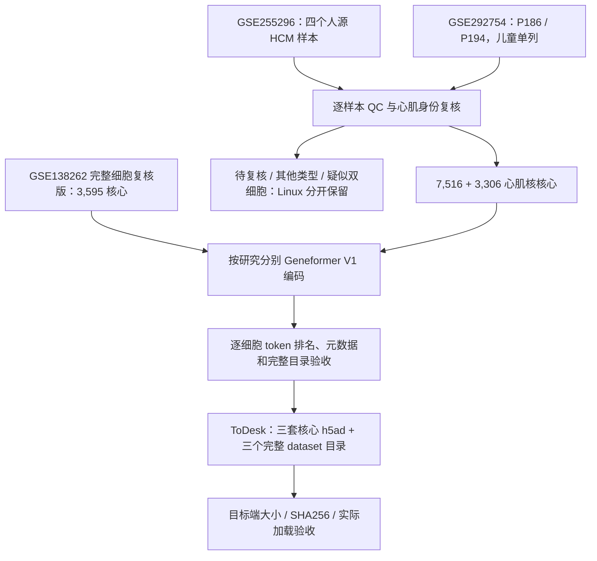

# 新增 HCM 数据：QC、Geneformer V1 编码与交付

日期：2026-11-14。新增两套 QC 和本批三套 Geneformer V1 编码均已验收；ToDesk 传输正在进行。

## 本批范围和结果

| 数据 | 发布条码/来源完整细胞 | 严格单核数值候选/完整细胞作者深度候选 | 心肌身份核心 | 待复核候选 | 核心供体标识 |
|---|---:|---:|---:|---:|---:|
| GSE255296 | 48,873 | 27,815 | 7,516 HCM | 17,464 | 4 |
| GSE292754 | 30,187 | 27,499 | 3,306 HCM | 894 | 2 |
| GSE138262 完整细胞版及其伴随健康数据 | 7,537 | 3,692 | 2,216 HCM + 1,379 Control | 97 | 5 HCM + 7 Control |

本批编码核心合计 **14,417**，每研究分别输出。供体标识数不是已经证实的跨研究独立患者数。两套新增资源都只有 HCM；GSE292754 的 P186/P194 是 14/16 岁女性，儿童单列；GSE255296 个体年龄仍未确认。未重复添加论文复用的 Chin 对照/病例，也未重复添加儿童 P86。

“待复核”由宽松的心肌候选触发规则产生，包括参考标签非心肌但存在多个心肌标记的条码，不能解读成已确认心肌细胞被删除。GSE255296 待定候选中 16,857 个原始 SingleR 最佳标签非心肌，635 个有强混合谱系标记；各原因可重叠。未放宽门槛把这些候选加入编码，全部仍保留在 Linux 待定对象和全条码审计中。



## 清洗规则与实际校验

新增单核执行约定项目基线 **500≤检测基因≤5000、线粒体计数比例 <5%**。全部基因先参与 QC，未先移除线粒体规避门槛；不删除低表达基因以改变 Geneformer 输入空间。

心肌核心要求 SingleR 最佳/剪枝标签均为心肌、至少两个心肌面板基因有表达、心肌程序占优，并满足正常参考尾部或强心肌标记加邻域支持；有强混合谱系冲突者待定。scDblFinder 每个捕获独立建模，输入包含 ≥500 基因的全部类型及高 MT/高复杂度条码。算法调用与强混合程序共同支持才另存疑似双细胞；算法单独调用、弱跨谱系表达不是实验确证。

新增数据实际没有 0<UMI≤100 的背景条码，未运行 EmptyDrops，也未伪造液滴 FDR 或 SoupX 复核。发布矩阵的上游去背景历史尚未确认；原文使用某工具不证明发布文件已执行该步骤。固定正常成人 LV 单核参考的训练/校准供体分开，参考阈值是项目启发式，并不是独立 HCM 准确率；对儿童和室间隔存在域差异。

GSE138262 按此前[完整细胞来源特异规则](hcm-whole-cell-qc-review.md)处理：作者最终纳入且非 MT UMI>1000，再做心肌身份共识；不套单核 MT<5% 和 5000 基因上限。该研究的健康伴随数据来自另一研究和技术，疾病与技术/研究混杂。

新增两套独立检查分别 **336 项和 228 项全部通过**，重新读取原始 MTX，核对所有输出的原生基因轴、逐值计数、QC 指标、来源标签、完整条码分区、混合/身份/邻域规则和文件摘要。GSE138262 前一步 71 项检查通过。计数交付的 `X` 与 `layers['counts']` 为未改动的发布整数计数；所有来源基因保留，缺测掩码不丢失，诊断归一化副本不作为编码计数输入。

## V1 编码与位置

使用官方 `TranscriptomeTokenizer`，源码固定 revision `1f7fbae4e469a5f4f1af8c111a529cfe1b3829f5`，V1 词表 25,426，最大 2048 token，无 CLS/EOS。排名按每细胞总计数归一化后除以官方基因 median，再降序，不能简化为原始表达量降序，也不能只说保留蛋白编码基因。词表中受支持的 miRNA 等同样由官方规则处理。

编码副本保留原计数、原生基因轴、缺测掩码及原有注释。GSE138262 的索引是 `ENSG..._symbol`，实际使用 `var['gene_id']`，避免误做 symbol 映射。编码保留疾病、供体、样本、来源研究、年龄层、技术、组织和临床阶段，`split=unassigned`。

Linux 计数核心：

```text
/home/zhome/hcm-geneformer-data/processed/GSE255296_qc_20261114/cm_qc_full.h5ad
/home/zhome/hcm-geneformer-data/processed/GSE292754_qc_20261114/cm_qc_full.h5ad
/home/zhome/hcm-geneformer-data/processed/GSE138262_whole_cell_qc_20261114/cm_qc_full.h5ad
```

ToDesk 正式目标（电脑 `DESKTOP-74N1LUH`）：

```text
D:/hcm-geneformer-data/
  processed/GSE255296_qc_20261114/cm_qc_full.h5ad
  processed/GSE292754_qc_20261114/cm_qc_full.h5ad
  processed/GSE138262_whole_cell_qc_20261114/cm_qc_full.h5ad
  tokenized/geneformer_v1_20261114/datasets/
    GSE255296.dataset/
    GSE292754.dataset/
    GSE138262_whole_cell.dataset/
  deliveries/hcm_expansion_20261114/
```

每个 `.dataset` 是包含 Arrow、`dataset_info.json`、`state.json` 的完整目录。模型训练史、跨研究供体独立性及训练/验证角色仍待核实；本批完成编码不等于批准混合训练或独立验证。未做 DGE、微调或模拟敲除。

## 编码验收

96 个 smoke 细胞及全量 14,417 个细胞均通过独立验收：来源计数、全部 metadata、合法 token、无重复、按 median 缩放后的降序排名、实际长度和截断边界全部核对。三套来源文件 SHA256 前后一致，编码副本的原生缺测掩码也逐项一致。CSR 内部列顺序规范化只改变存储布局，重新按每个细胞×基因坐标核对值完全相同。

| 数据 | 最短/中位/最长 token 序列 | 截断为 2048 的细胞 |
|---|---|---:|
| GSE255296 | 425 / 1388.5 / 2048 | 2703（36.0%） |
| GSE292754 | 452 / 1708 / 2048 | 1168（35.3%） |
| GSE138262 完整细胞 | 461 / 1471 / 2048 | 1171（32.6%） |

QC 的检测基因数计算全部原生基因，编码长度只计算 V1 词表内的表达基因，因此序列可能短于 500；这不代表绕过 QC。

代码：[src/qc_hcm_expansion_20261114](../src/qc_hcm_expansion_20261114/README.md)。QC 证据：[nuclear](../results/qc/hcm_expansion_20261114/nuclear/)。[全量 token 验收](../results/qc/hcm_expansion_20261114/v1_delivery/FULL_VERIFICATION.json)、[交付文件大小/MD5/SHA256](../results/qc/hcm_expansion_20261114/v1_delivery/DELIVERY_MANIFEST.tsv)、[打包摘要](../results/qc/hcm_expansion_20261114/v1_delivery/PACKAGE_STATUS.json)。目标端验收记录在实际通过后附入。
