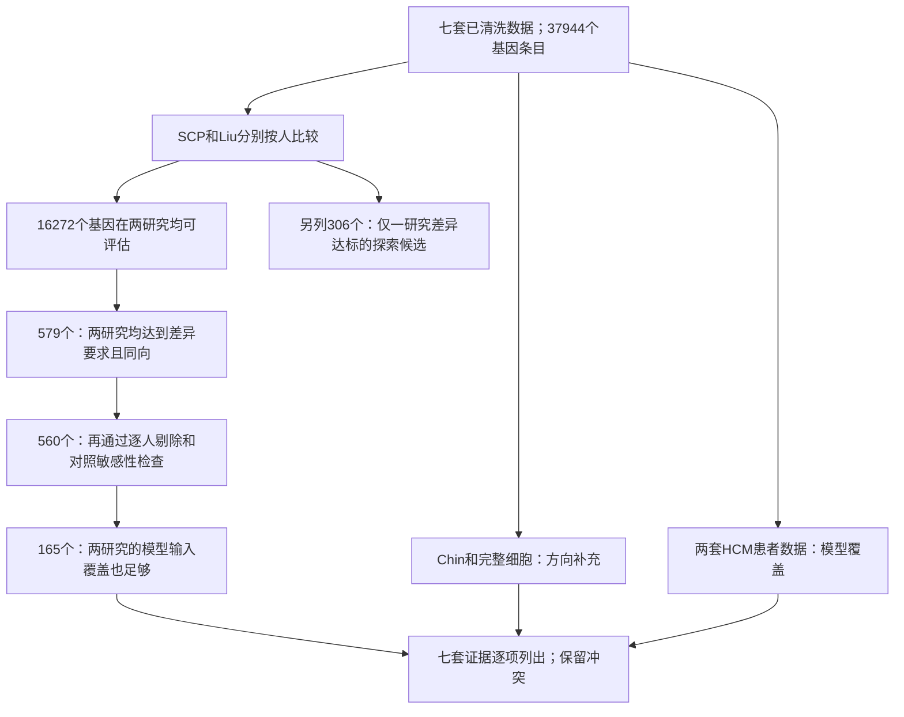

# 第二版结果：从七套数据寻找共同候选基因

2026-11-15。本轮按用户提出的“在不同研究中寻找共性”重新扩大筛选范围，得到 **165 个优先候选**。它们在 SCP1303 和 Liu2023 中都达到预定差异要求、变化方向相同，通过稳定性检查，并且在两个研究的模型输入中都有足够覆盖。

其中 **80 个来自第一版 200 名单，85 个是本轮新增**。另有 **306 个证据较弱的探索候选**，单独保存，没有混入上述 165 个。这些结果仍是待测试的表达关联，不表示敲除已经被证明有益。

先看 [165 个共同候选中文表](COMMON_CANDIDATES_REVIEW.csv)，需要细节时看 [完整候选证据](A_SIMULATABLE.tsv)。[306 个探索候选](EXPLORATORY_CANDIDATES_REVIEW.csv)和[旧 200 个的去向](PREVIOUS_200_REVIEW.csv)分别列出。

## 这次与第一版有什么不同

第一版先从 SCP1303 选 200 个，再用 Liu 检查。第二版让 **SCP 和 Liu 都从各自全部可比较的基因开始**，再找共同信号，因此不会被旧名单提前限制范围。

七套数据没有直接混成一张表，也没有把同一人的细胞当成许多独立患者。表达比较继续使用清洗后的心肌细胞/细胞核原始表达计数，先按人汇总；模型转化后的序列只用于检查候选是否真的能进入模型。

| 数据 | 本轮实际完成的工作 | 能说明什么 |
|---|---|---|
| SCP1303，15 HCM + 16 非衰竭对照 | 使用全部受检基因、原先的年龄/性别调整和 31 次逐人剔除结果 | 主要疾病差异证据之一 |
| Liu2023，10 HCM + 2 对照 | 全部可映射基因重新计算并导出，分别去掉两位对照再检查方向 | 主要疾病差异证据之一；本轮不再是留出验证 |
| GSE174691 + GSE161921，9 HCM + 4 对照 | 全部共同可比较基因的方向和幅度 | 患者与对照来源重合的补充观察；这两套合起来只是一项比较 |
| GSE138262 完整细胞，5 HCM + 7 对照 | 在所有样本都实际测量的基因中检查方向和幅度 | 存在研究/技术差异的补充观察 |
| GSE255296，4 位 HCM | 全基因计数检测与实际模型序列覆盖；年龄尚待确认 | 另一批患者是否能提供候选的模型输入 |
| GSE292754，2 位儿童 HCM | 同上，儿童单列 | 儿童数据的候选覆盖，不证明疾病差异 |

这些数据共 151,359 条心肌细胞/细胞核记录、74 个研究内人员记录；跨研究重复人员仍未完全排除。两套只有患者的数据没有补造对照，来源混杂的比较也没有与 SCP/Liu 等权投票。

[本轮人员与用途表](DONOR_ROSTER_CURRENT.tsv)记录当前分工，并保留旧用途字段。证据包 `input/pb/DONOR_ROSTER.tsv` 是第一版的原样快照，其中 Liu 的旧“留出复核”角色只表示历史状态，不是本轮用途。

## 如何得到这 165 个

| 筛选步骤 | 真实数量 |
|---|---:|
| 来源基因合并登记，未按旧 200 限制 | 37,944 |
| SCP 中信号足够、能够比较的基因 | 20,172 |
| Liu 中信号足够、能够比较的基因 | 16,334 |
| 两项研究均可比较 | 16,272 |
| 两项研究均达到差异要求，且变化方向一致 | 579 |
| 上述基因再通过稳定性要求 | 560 |
| 上述基因再满足两项研究的模型覆盖要求 | **165** |

SCP 自身有 4,369 个达到差异门槛的基因，Liu 有 3,533 个；它们同向的交集为 579。稳定性检查保留 560 个，另 19 个对样本变化较敏感，仍在全表中。

560 个共同生物学候选中，有 395 个未达到本轮的模型覆盖要求，因此没有进入优先模拟表；这不等于它们没有生物学意义。[完整生物学候选](A_BIOLOGICAL.tsv)与模型可用候选分别保存。

165 个优先候选中，**59 个在 HCM 较高，106 个较低**。计划上限为 200，实际合格多少就保留多少，未为凑满 200 放宽条件。排序同时考虑两个研究中较弱的一方，而不是只看 SCP 的排名。

模型覆盖的要求是：SCP 的 15 位患者中至少 8 位、Liu 的 10 位患者中至少 5 位，各自至少 10% 心肌细胞核的实际输入序列包含这个基因。

## 在其余数据中也都一致吗

**不是所有补充数据都一致。** 165 个的“共同支持”明确指 SCP 和 Liu 两项主要比较；其他研究的支持和冲突都保留：

| 补充比较 | 同向 | 反向 | 无法比较 |
|---|---:|---:|---:|
| Chin 两套成对比较 | 123 | 24 | 18 |
| GSE138262 完整细胞 | 61 | 46 | 58 |

其中 **48 个在 Chin 和完整细胞两项补充比较中也都同向**；**63 个至少在一项补充比较中反向**。这两个数字描述的是上述 165 个的支持组合，不能把反向结果藏起来。其余候选可能只有部分支持，或某项无法比较。

GSE255296 有 149/165 个、儿童 GSE292754 有 156/165 个，在至少半数患者各至少 10% 的心肌细胞核输入中出现；两套均满足这一覆盖条件的有 145 个。这只是“模型能看到”的证据，不能当成第三、第四次疾病差异验证。

无法比较包括缺少共同实测基因或信号不足，不被当成表达为零，也不被当成反向。[七套逐项证据表](SEVEN_DATASET_EVIDENCE.tsv)和[支持情况组合](SUPPORT_PATTERNS.tsv)保留这些区别。

## 306 个探索候选是什么

这一层在两个研究中同向且通过稳定性和模型覆盖检查，但**只有一个研究达到完整的差异门槛**：162 个主要由 SCP 支持，144 个主要由 Liu 支持。

它们可能提供补充线索，但不能称为“两项研究都发现了明确差异”。该层共有 1,265 个生物学候选，其中 306 个模型覆盖足够，具体方向为 **123 个 HCM 较高、183 个较低**。探索层全部单列，没有用来给优先层补数。

## 原来的 200 个去了哪里

| 本轮去向 | 数量 |
|---|---:|
| 进入 165 个共同优先候选 | 80 |
| 进入 306 个探索候选 | 54 |
| 共同证据通过，但本轮要求的双研究模型覆盖不足 | 4 |
| 探索证据通过，但模型覆盖不足 | 3 |
| 不符合本轮分层规则 | 59 |
| **合计** | **200** |

第一版文件和顺序完整保留。新名单用途更强调跨研究共同性，判断条件也增加了 Liu 差异幅度、稳定性和模型覆盖要求；未进入新优先表不代表旧文件丢失或旧表达值被修改。[逐基因比较表](PREVIOUS_200_COMPARISON.tsv)给出每个原因。

## 怎么看待这轮结果

本方案在第二版全量比较前写定并保存为提交 [aefa26c](https://github.com/zhome1226/hcm-geneformer/commit/aefa26c)，详见[执行方案](DESIGN.md)。不过，第一版的 SCP 全量与 200 个候选的 Liu 结果早已看过，所以本轮应称为**扩展探索**，不能包装成事先完全不知道结果的独立验证。

Liu 只有两位对照；两次去掉对照的检查仍共享同一批患者，不是两个新研究。各研究自己的统计校正值和变化幅度保留在证据表中；两个研究分别筛选后取交集，不代表最后名单自动具有一个统一的错误率保证。

模型训练史、跨研究同人、未记录的临床因素、清洗造成的选择偏差仍会影响解释。当前没有模型训练、模拟敲除或真实干预实验；共同变化也可能是疾病后果或保护反应。

## 文件与复现

独立核对已通过：来源及原 200 名单保持一致、两研究全基因统计校正、31 次逐人剔除、七套 2,807,856 行逐供体基因覆盖、分层条件和排序均已重新核算。新 Liu 结果与第一版 200 个对应结果逐列一致。

核对过程中发现一次浮点边界差异：核对脚本原先“先除后乘”，官方软件“先乘后除”，使 Chin 中 29 个恰在低表达边界的基因判定不同。已依据官方实现修正核对脚本，最终通过；分析软件结果、数据和筛选门槛未改变。失败记录、原因诊断和修复后验收均保留。

- Linux：`/home/zhome/hcm-geneformer-analysis/hcm_consensus_20261115/`；原始输入快照、完整结果和逐供体记录均保留。
- 本机：`D:/VirtualCell/deliverables/hcm-consensus-20261115/`；106 个分析证据文件已逐项核对与 Linux 一致，详见[本机验收](LOCAL_ACCEPTANCE.json)。
- 手动传输包：`D:/VirtualCell/deliverables/HCM_CONSENSUS_20261115_complete.zip`，包含本轮全部表格、通俗总览、报告和检查凭据；建议在 ToDesk 解压到 `D:/hcm-geneformer-data/analysis/`。打包完成不代表目标端已接收。
- GitHub：保存代码、小型候选表、报告与检查凭据；全基因大表和逐供体明细随完整压缩包交付。
- 完整来源、输出摘要、独立核对结果分别见 [PREPARATION.json](PREPARATION.json)、[EVIDENCE_MANIFEST.json](EVIDENCE_MANIFEST.json)、[FINAL_AUDIT.json](FINAL_AUDIT.json)；核对不等于第二次独立模型拟合。
- 源码与字段解释见[代码说明](../../../src/hcm_consensus_20261115/README.md)。

下一步应确定实际 V1 模型和评价方案，再逐基因模拟这 165 个优先候选。306 个探索候选和原有名单保留，供后续分层比较；最终独立检验需要新的人员或研究。
