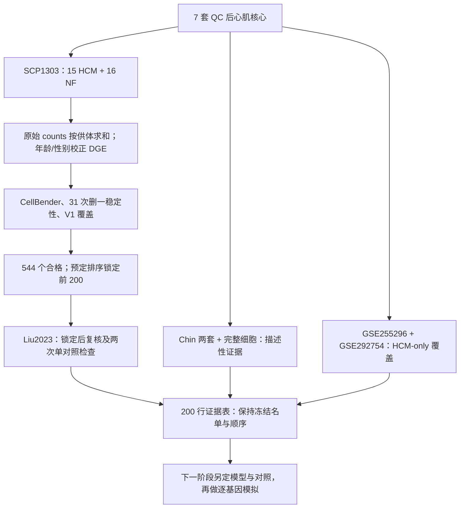

# HCM 候选靶点发现与留出队列方向复核

2026-11-15。已完成本阶段供体级分析，锁定 **200 个 Geneformer V1 待扰动候选**，其中 HCM 较高 101 个、较低 99 个。Liu2023 中 158 个与发现队列同向，其中 141 个在分别去掉任一位对照后仍同向；42 个反向。**这些是表达关联候选，不是已证明敲除有益的治疗靶点。**

先打开 [200 个候选中文审阅表](CANDIDATES_REVIEW.csv)；详细数值见 [完整证据表](CANDIDATE_EVIDENCE.tsv)。表格保持揭盲前冻结的序号，没有根据 Liu 结果删基因或重新排序。

## 七套数据分别做了什么

|来源|HCM 供体 / 核或细胞|对照供体 / 核或细胞|本次用途|
|---|---:|---:|---|
|SCP1303|15 / 54,344|16 / 60,367|唯一发现队列；对照为非衰竭 NF|
|Liu2023|10 / 4,718|2 / 3,829|锁定后方向复核；CL0412A/B 属同一对照供体|
|GSE174691|9 / 10,150|无|与下一行成对作描述性差异|
|GSE161921|无|4 / 3,534|accession 与疾病完全重合，不能分离疾病与来源效应|
|GSE138262 完整细胞|5 / 2,216|7 / 1,379|来源/技术与疾病混杂，仅描述性对照|
|GSE255296|4 / 7,516|无|成人 HCM 的基因检测与实际 token 覆盖|
|GSE292754|2 / 3,306|无|14/16 岁儿童 HCM 的覆盖，单独列报|

合计 151,359 个核/细胞、74 个**研究内供体条目**。跨研究同人的排查限于现有标识/别名，没有发现完全相同的别名；这不能证明是 74 个互不重复的人。SCP1303 中 29 人各有两次捕获，按人合并，不把捕获样本或细胞当独立重复。见 [供体表](DONOR_ROSTER.tsv)、[样本表](SAMPLE_ROSTER.tsv)。

## 发现规则与真实筛选结果

方案在查看疾病差异结果前写入 [DESIGN.md](DESIGN.md)，对应提交 [5019f70](https://github.com/zhome1226/hcm-geneformer/commit/5019f70)。输入为现有 QC 后、tokenize 前 .h5ad 的整数计数；不使用 token、log 表达或整合表达做 DGE，也没有重新清洗或更改原数据。

SCP1303 主分析使用 `layers/cellranger_raw`，按供体求和，用 edgeR 4.8.2 的 TMM、robust 准似然检验，设计为年龄（线性中心化）+ 性别 + 疾病；设计矩阵满秩。方向统一为 HCM 减 NF。采用预先固定的表达过滤，在全部 20,172 个受检基因上作 BH 校正。

|步骤|基因数|HCM 较高|HCM 较低|
|---|---:|---:|---:|
|通过表达过滤并检验|20,172|9,831|10,341|
|FDR < 0.05 且绝对 log2FC ≥ 0.5|4,369|2,507|1,862|
|其中 CellBender 敏感性同向|4,111|2,506|1,605|
|再满足全部 31 次删一同向、最小绝对 log2FC ≥ 0.25|4,108|2,503|1,605|
|再满足明确 V1 token、至少 8/15 人各 ≥10% 核含该 token|544|249|295|
|按 FDR、绝对效应、Ensembl ID 预定顺序取前 200|200|101|99|

上述阈值是本项目预先规定的探索筛选标准，不是行业强制标准。FDR 对应零效应检验，再附加观测效应筛选；没有把它称为“真实效应至少 0.5”的显著性检验。

作者 CM-HHATL 亚型保留 99,011 核、31 位供体，200 个候选在该亚型分析中均同向。此项只作敏感性检查，不参与入选排序；单一亚型同向也不能排除所有心肌亚型组成或疾病状态的影响。31 次删一用于检查单个供体的影响，不是 31 次独立重复，删一范围也不是置信区间。

## Liu2023 复核结果

200 个候选均有可评估的映射和表达。Liu 用 12 位供体的 pseudobulk、TMM 与疾病主效应模型；受限于两位对照，未套用 SCP 的年龄/性别设计。统计在全体 16,334 个通过表达过滤的基因上计算 BH FDR，最后才取出冻结的 200 行。

|方向证据|数量|含义|
|---|---:|---|
|主分析同向且两次单对照仍同向|141|分别只保留 CL2 或 CL0412 时，方向仍与 SCP 一致|
|主分析同向，但对照敏感|17|主分析同向，至少一次单对照分析不能维持同向|
|主分析反向|42|如实保留，后续机制与模拟解释必须考虑冲突|
|无法评估|0|本批没有无法评估的 Liu 候选|

主分析同向总计 158/200（79%）。其中 86 个还满足 Liu 全基因 FDR < 0.05；反向者中 5 个满足该 FDR 阈值。单独去掉 CL0412 和 CL2 时分别有 159 和 160 个同向，这两个数包含了部分主分析反向的基因，不能直接代替上表 141 个的联合条件。

两个单对照分析共享 HCM 供体，不能称为两次独立验证。未显著不等于与发现矛盾，同向也不等于因果或治疗有效。名单锁定后才读取复核差异，最终保留全部 200 行与原排序。

## 其余队列提供的证据

Chin 成对对照在 171 个可评估候选中有 119 个同向、52 个反向；29 个未通过该比较的表达过滤。GSE138262 完整细胞只在各样本共同实测的 5,488 个基因上比较，候选中 109 个可评估（63 同向、46 反向），91 个不在共同可测/通过过滤范围。未评估值保留 NA，没有填成“零表达”。

这两项是供体 TMM 归一化后 `log2(CPM + 0.5)` 中位数之差，不是主模型 log2FC，也没有报告疾病显著性。两者都存在疾病与来源或技术混杂，不能当成独立疾病效应检验。

两套 HCM-only 数据都能在实际 V1 序列中找到全部 200 个候选；这是“至少某些细胞可扰动”，不代表每个细胞都含该基因。在至少半数供体各 ≥10% 核出现该 token 的候选数，GSE255296 为 166/200，儿童 GSE292754 为 182/200。该统计只描述覆盖，没有用来补筛或重排候选。完整逐供体覆盖随证据归档保存。

## 验收与文件位置

- [FINAL_AUDIT.json](FINAL_AUDIT.json)：独立计算核对脚本通过供体/样本对应、计数守恒、原生可测掩码、表达过滤、SCP 全基因 BH、31 次删一、候选顺序、覆盖汇总和最终表联接。Liu 核查校正全集规模、缺失/过滤状态及表间一致性；未把该核对声称为第二次独立模型拟合。
- [LOCK.json](LOCK.json) 与 [冻结名单](CANDIDATES.tsv)：锁定时间 2026-11-15 04:26:03 UTC（北京时间 12:26:03），SHA256 为 `d2fc63ed14d76c8d291afd09c067c0339584f38550369c8691248e0126bfa09d`。
- [输入清单](INPUT_SOURCES.tsv)、[发现计数审计](DISCOVERY_PSEUDOBULK.json)、[复核计数审计](SUPPORT_PSEUDOBULK.json)：保留真实输入路径与 SHA256。旧 Linux 输入路径中的历史名称仅为准确定位；本轮新输出目录使用中性名称。
- Linux 工作目录：`/home/zhome/hcm-geneformer-analysis/hcm_dge_20261115/`；其中 `pb/` 保存分析用供体汇总矩阵，`stats/`、`coverage/`、`lock/`、`final/` 保存全量结果。
- 本机交付目录：`D:/VirtualCell/deliverables/hcm-dge-20261115/`；中文 CSV 可用 Excel 打开，`evidence/` 含全量发现表、31 次删一效应、逐供体覆盖、计数/映射审计、脚本与日志。
- 归档 `evidence.tar.gz`：21,990,052 字节，80 个分析证据文件；原始细胞矩阵和全量 pseudobulk 矩阵未打包。[本机验收](LOCAL_ACCEPTANCE.json) 确认归档及 80 文件 SHA256 与 Linux 一致；[逐文件清单](EVIDENCE_MANIFEST.json) 可追溯。
- GitHub 只提交本轮代码、小型结果与文字；完整证据压缩包保存在本机和 Linux。ToDesk 旧交付包仍由用户自行传送，本阶段未开启任何 ToDesk 传输。

## 下一步边界

本阶段没有训练或运行模拟敲除。下一步需确定具体 V1 checkpoint、状态参照和表达/token 覆盖匹配的背景扰动对照，再锁定逐基因模拟方案。

SCP1303 与 Geneformer 原论文心肌病材料存在来源重叠，模型训练史、预训练语料交集和跨研究供体重复仍未完全核实；本轮 DGE 的发现/复核分工不等于模型训练/测试划分，也不据此声称模型外部独立验证。SCP 模型只调整可用的年龄/性别，不能排除用药、疾病严重程度等未建模的临床因素。候选内上调和下调都不能直接翻译成“应当敲除”。

统计依据与 Geneformer 官方文档见[项目策略](../../../docs/hcm-target-strategy.md)；执行脚本和重现顺序见 [代码说明](../../../src/hcm_dge_20261115/README.md)。
